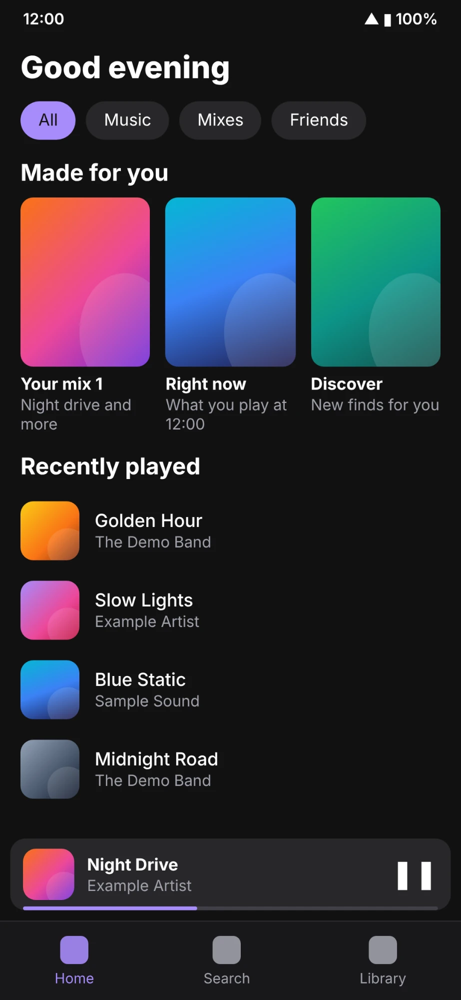
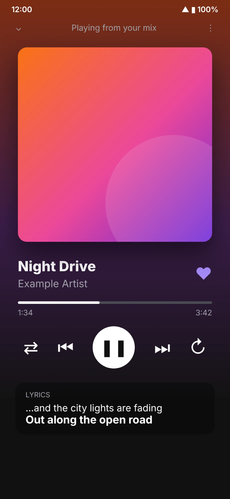
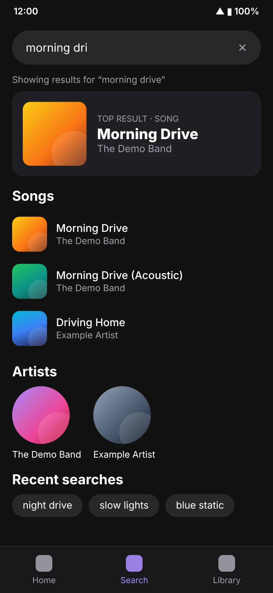
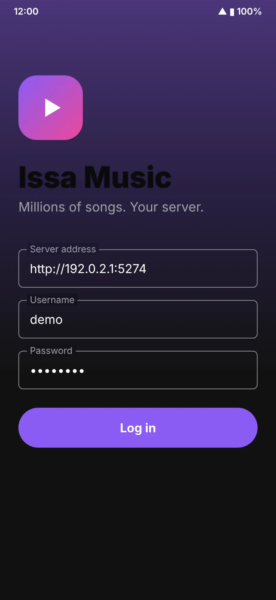
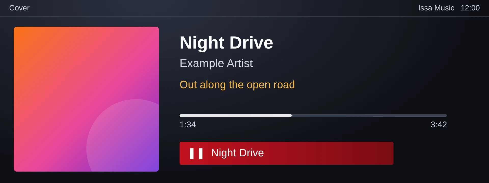

# 🎵 Issa Music

A private music app I built myself: one app for the phone, the car and the TV, streaming from my own music server at home.

## 📸 Screenshots

  
  
  
  

<b>In the car:</b> cover, song and synced lyrics on the BMW iDrive screen

  

Shown with demo songs and a placeholder server address.

## ✨ What it does

**📱 Phone**
- Plays music in the background, with media controls on the lock screen
- Cover art, a progress bar and time-synced lyrics while a song plays
- Search across the whole library

**🚗 Car (BMW iDrive)**
- Album cover and *previous / now playing / next* shown on the car's own screen
- Track changes pop up as notifications in the car
- Control playback with the iDrive knob and the steering wheel buttons
- Connects by itself a few seconds after the phone joins the car's Bluetooth

**📺 TV**
- A big, remote-friendly screen for Android TV
- Play, pause and skip with the TV remote

**🏠 At home**
- Music comes from my own server, so nothing depends on a paid streaming service
- A web player and a Windows app use the same library

## 🛠️ Built with

Kotlin · Android Media3 · Android TV · BMW Apps integration (based on the open-source AAIdrive project) · a self-hosted Subsonic-compatible music server

## 🔒 About this repository

This repository is a showcase only. The source code, the app and the server are private and are not available for download.

---

Made by Mohammad Issa
